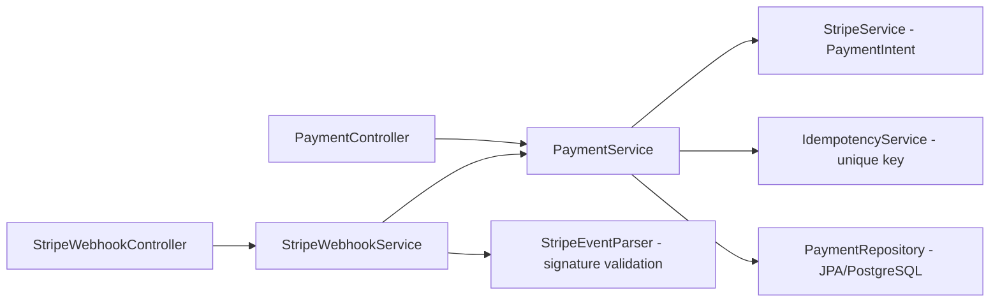

# kodapay-api-v2

**English** · [Português (Brasil)](README.md)

[](#) [](#) [](#) [](#) [](#) [](LICENSE)

## What it is

A **REST payment API (version 2)** integrated with **Stripe**: it creates Stripe PaymentIntents, processes **webhooks** (payment confirmed/failed) with signature validation and applies **idempotency** to prevent duplicate payments. Persistence is in **PostgreSQL** (JPA). It is the evolution of `kodapay-api` with real payment-processor integration.

## Status

A working, tested API (27 tests, BUILD SUCCESS). For production, the Stripe keys are required (see Prerequisites).

## Features

- **Stripe PaymentIntent creation** (`StripeService`): amount in cents, currency, secret-key configuration.
- **Stripe webhooks** (`StripeWebhookService` + `StripeEventParser`): handles `payment_intent.succeeded` and `payment_intent.payment_failed`, validating the signature (`Webhook.constructEvent`).
- **Idempotency** (`IdempotencyService`): an idempotency key prevents creating the same payment twice (conflict → `IdempotencyConflictException`).
- **Payment CRUD** with states (`PaymentStatus`: PENDING, FAILED, COMPLETED).
- **JPA + PostgreSQL persistence** with `ddl-auto=validate`.
- **Error handling** via `GlobalExceptionHandler` (404, idempotency conflict, invalid signature).

## Architecture

controller → service → domain layers with PostgreSQL (JPA), Stripe integration and in-memory idempotency (MVP).



## Stack

- Java 21, Spring Boot 3
- Stripe SDK (`stripe-java` 34.0), Spring Web, Validation, Data JPA
- PostgreSQL
- JUnit 5 / Spring Test

## Repository layout

```
kodapay-api-v2/
├── pom.xml · mvnw
├── src/main/java/com/kodapay/api/
│   ├── controller/       # PaymentController, StripeWebhookController
│   ├── service/          # PaymentService, StripeService, StripeWebhookService,
│   │                     # StripeEventParser, EventParser, IdempotencyService
│   ├── domain/           # Payment, PaymentRepository, PaymentStatus
│   ├── exception/        # GlobalExceptionHandler + specific exceptions
│   └── controller/dto/   # PaymentRequest, PaymentResponse
└── src/main/resources/application.properties
```

## Endpoints

| Method | Route | Description |
|--------|-------|-------------|
| POST | `/payments` | Creates a payment (Stripe PaymentIntent) with `currency`, `amount`, `idempotencyKey` |
| GET | `/payments/{id}` | Fetches a payment by id |
| POST | `/webhooks/stripe` | Receives a Stripe event (validates the signature) |

`PaymentRequest`: `currency` (required), `amount` (> 0), `idempotencyKey` (required).

## Prerequisites and installation

- JDK 21, Maven 3.9+
- PostgreSQL (default `jdbc:postgresql://localhost:5432/kodapay`, user `kodapay`)
- Stripe keys via variables/`application.properties`:
  - `kodapay.stripe.secret-key`
  - `kodapay.stripe.webhook-secret`

```bash
git clone https://github.com/KelvinOliveiraCode/kodapay-api-v2.git
cd kodapay-api-v2
```

## How to run

```bash
./mvnw spring-boot:run
# API at http://localhost:8080
```

## Tests and quality

Real command (verified by the agent, Maven 3.9.16 / JDK 21):

```bash
mvn -B test
# Tests run: 27, Failures: 0, Errors: 0 — BUILD SUCCESS
# (PaymentController 5, StripeWebhookController 2, Idempotency 6, PaymentService 9,
#  StripeService 1, StripeWebhookService 4)
```

There is no CI configured in this repository.

## Technical decisions and trade-offs

- **API-level idempotency**: protects against duplicate payments on retries; in memory in the MVP.
- **Webhook signature validation**: rejects forged events.
- **PostgreSQL with `ddl-auto=validate`**: expects a valid schema rather than generating blindly in production.

## Known limitations and roadmap

- In-memory idempotency (state lost on restart) — migrate to persistence.
- Stripe keys are not embedded; external configuration is required.
- No CI configured.

## Development process

An individual project by Kelvin Oliveira, built with orchestrated AI agents and reviewed by the author. The Stripe integration, the idempotency and the review are the author's.

## License and author

MIT — Copyright (c) 2026 Kelvin Rebelo de Oliveira.

**Author**: [Kelvin Oliveira](https://github.com/KelvinOliveiraCode) · [Portfolio](https://kelvinoliveiracode.github.io/portfolio/)
