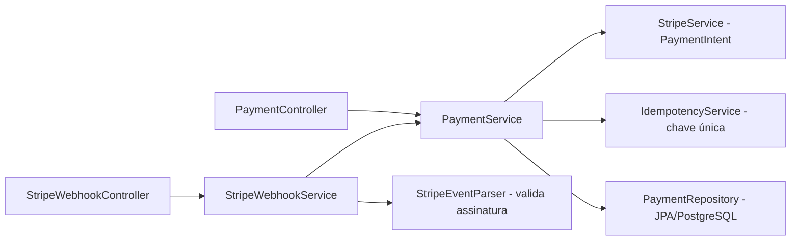

# kodapay-api-v2

[English](README.en.md) · **Português (Brasil)**

[](#) [](#) [](#) [](#) [](#) [](LICENSE)

## O que é

**API REST de pagamentos (versão 2)** integrada ao **Stripe**: cria PaymentIntents via Stripe, processa **webhooks** (pagamento confirmado/falhou) validando a assinatura e aplica **idempotência** para evitar pagamentos duplicados. Persistência em **PostgreSQL** (JPA). É a evolução da `kodapay-api` com integração real de processador de pagamentos.

## Status

API funcional e testada (27 testes, BUILD SUCCESS). Para produção, faltam as chaves Stripe (ver Pré-requisitos).

## Funcionalidades

- **Criação de PaymentIntent no Stripe** (`StripeService`): valor em centavos, moeda, configuração por chave secreta.
- **Webhooks Stripe** (`StripeWebhookService` + `StripeEventParser`): lida com `payment_intent.succeeded` e `payment_intent.payment_failed`, validando a assinatura (`Webhook.constructEvent`).
- **Idempotência** (`IdempotencyService`): chave de idempotência evita criar o mesmo pagamento duas vezes (conflito → `IdempotencyConflictException`).
- **CRUD de pagamentos** com estados (`PaymentStatus`: PENDING, FAILED, COMPLETED).
- **Persistência JPA + PostgreSQL** com `ddl-auto=validate`.
- **Tratamento de erros** via `GlobalExceptionHandler` (404, conflito de idempotência, assinatura inválida).

## Arquitetura

Camadas controller → service → domain com PostgreSQL (JPA), integração Stripe e idempotência em memória (MVP).



## Stack

- Java 21, Spring Boot 3
- Stripe SDK (`stripe-java` 34.0), Spring Web, Validation, Data JPA
- PostgreSQL
- JUnit 5 / Spring Test

## Estrutura do repositório

```
kodapay-api-v2/
├── pom.xml · mvnw
├── src/main/java/com/kodapay/api/
│   ├── controller/       # PaymentController, StripeWebhookController
│   ├── service/          # PaymentService, StripeService, StripeWebhookService,
│   │                     # StripeEventParser, EventParser, IdempotencyService
│   ├── domain/           # Payment, PaymentRepository, PaymentStatus
│   ├── exception/        # GlobalExceptionHandler + exceções específicas
│   └── controller/dto/   # PaymentRequest, PaymentResponse
└── src/main/resources/application.properties
```

## Endpoints

| Método | Rota | Descrição |
|--------|------|-----------|
| POST | `/payments` | Cria um pagamento (Stripe PaymentIntent) com `currency`, `amount`, `idempotencyKey` |
| GET | `/payments/{id}` | Busca um pagamento por id |
| POST | `/webhooks/stripe` | Recebe evento do Stripe (valida assinatura) |

`PaymentRequest`: `currency` (obrigatória), `amount` (> 0), `idempotencyKey` (obrigatória).

## Pré-requisitos e instalação

- JDK 21, Maven 3.9+
- PostgreSQL (default `jdbc:postgresql://localhost:5432/kodapay`, usuário `kodapay`)
- Chaves Stripe via variáveis/`application.properties`:
  - `kodapay.stripe.secret-key`
  - `kodapay.stripe.webhook-secret`

```bash
git clone https://github.com/KelvinOliveiraCode/kodapay-api-v2.git
cd kodapay-api-v2
```

## Como executar

```bash
./mvnw spring-boot:run
# API em http://localhost:8080
```

## Testes e qualidade

Comando real (verificado pelo agente, Maven 3.9.16 / JDK 21):

```bash
mvn -B test
# Tests run: 27, Failures: 0, Errors: 0 — BUILD SUCCESS
# (PaymentController 5, StripeWebhookController 2, Idempotency 6, PaymentService 9,
#  StripeService 1, StripeWebhookService 4)
```

Não há CI configurado neste repositório.

## Decisões técnicas e trade-offs

- **Idempotência na API**: protege contra pagamentos duplicados em retries; em memória no MVP.
- **Validação de assinatura de webhook**: rejeita eventos falsificados.
- **PostgreSQL com `ddl-auto=validate`**: espera um schema válido em vez de gerar às cegas em produção.

## Limitações conhecidas e roadmap

- Idempotência em memória (perde estado ao reiniciar) — migrar para persistência.
- Chaves Stripe não embutidas; exige configuração externa.
- Sem CI configurado.

## Processo de desenvolvimento

Projeto individual de Kelvin Oliveira, construído com agentes de IA orquestrados e revisado pelo autor. A integração Stripe, a idempotência e a revisão são do autor.

## Licença e autor

MIT — Copyright (c) 2026 Kelvin Rebelo de Oliveira.

**Autor**: [Kelvin Oliveira](https://github.com/KelvinOliveiraCode) · [Portfólio](https://kelvinoliveiracode.github.io/portfolio/)
